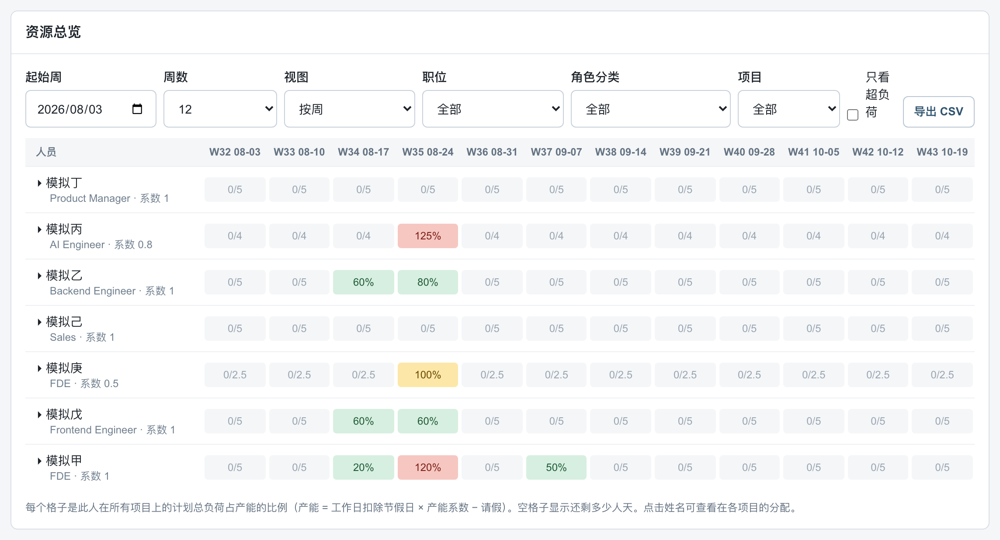

# ManDay 资源规划 · 产品案例

**在线查看 → https://naomi936.github.io/manday-case-study/**

一个给项目型团队用的内部资源规划工具：谁在哪个项目上、每周排了几个人天、谁已经超负荷、项目实际花了多少钱，都在同一套数据里回答。

我担任产品负责人，负责需求、逐页验收和规则决策；代码由 Codex 和 Claude Code 实现。

案例页包括：要解决的问题、使用流程、界面截图、6 个关键产品决策，以及从 v0.1 到 v0.5 的迭代过程。

*截图中的人员、项目和费用均为演示数据。产品本体部署在公司内部环境，这里只公开案例页。*
